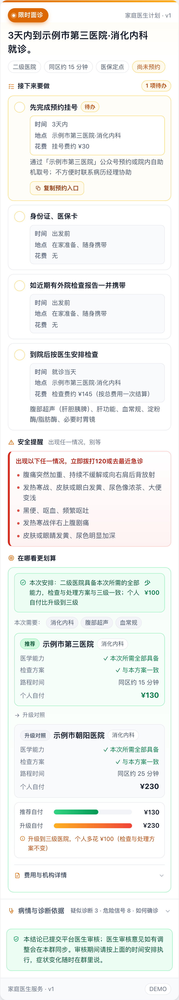

# 企微群「家庭医生 Agent」项目概述（汇报版）

> **一句话**：在患者已有的企微服务群里，用「硬安全门控 + 多轮问诊」生成一张真人医生审核过的**就医规划卡**——什么时候、去哪家医院、做什么、花多少钱，一目了然；轻症转居家观察闭环，重症立即升级。

## 30 秒版

- **是什么**：企微群里的 AI 家庭医生——把一句话咨询变成可执行的就医安排，而不是一句“建议就医”。
- **到哪了**：Demo 已完成，10 个分级样例群真实跑通，355 项测试、34 个评测用例；患者端手机卡片已可体验。
- **为什么值得投**：安全可控（红旗硬门控 + 真人医生审核）、能省钱（同方案下合理分流）、可规模化（每张卡片都是一次可追踪的服务履约）。
- **需要支持**：① 安排医学组审核规则与路径；② 批准 1–2 个真实群灰度试点；③ 协调机构/号源/医保数据接入。

---

## 一、要解决的问题

| 现状痛点 | 后果 |
| --- | --- |
| 群里咨询靠人工凭经验回复，质量不稳定 | 回复不一致、不可审计，患者体验差 |
| 患者不知道「去哪一级医院、做什么检查」 | 小病挤三甲、大病被拖延，医疗资源错配 |
| 费用不透明，不知道医保能报多少 | 患者多花冤枉钱，服务方难以证明价值 |
| 群消息 7×24 无人即时响应 | 延误风险 + 病历经理人力被重复问题占满 |

## 二、产品是什么

给患者的不是一句「建议就医」，而是一张**可执行的就医规划卡**（见文末配图）：

1. **首屏决策**：一句建议（含具体医院名）+ 关键事实（级别/距离/医保/预约状态）
2. **任务清单**：每条任务都必须讲清**四要素**——任务、时间、地点、花费；预约入口可一键复制
3. **安全底线**：风险信号合并去重后按「立即 120 / 今天内 / 尽快」分级展示
4. **在哪看更划算**：推荐机构与升级机构做四维对照（医学能力 / 检查方案 / 路程 / 个人自付），并给出「少花 X 元」结论
5. **依据可查**：疑似诊断及依据、重点排除风险、如何确诊、为什么这样安排——折叠展示，点开即有

## 三、核心机制（为什么可信）

1. **硬安全门控**：28 条红旗规则确定性筛查，先于大模型判断；模型不得把紧急程度降级（服务端强制），命中高危不等待模型直接给已审行动
2. **多轮问诊**：普通病例至少 2 轮、最多 4 轮追问后才给结论，信息不足时只问"最能改变去向"的问题
3. **确定性患者视图**：卡片内容由服务端从结构化计划**投影生成**，模型不重写临床方案，并通过语义一致性门控校验
4. **闭环与可追溯**：轻症创建居家观察任务（到点主动回访、未回复催办、超期强制复评）；消息发送幂等、断点续跑、全链路执行留痕

## 四、当前进展（可演示、可验证）

| 维度 | 进展 |
| --- | --- |
| 分级能力 | 覆盖 E0 立即急救 / E1 尽快急诊 / E2 当日 / E3 限时 / E4 门诊·观察 / E5 复诊 / EU 人工复核 |
| 样例群 | **10 个样例群**已用真实模型完整跑通（含 3 个急救、2 个居家观察带主动回访） |
| 自动化测试 | **355 项**测试（含前端渲染器、安全门控、契约不变量、去重与旧消息回退） |
| 评测体系 | **34 个评测用例**（企微 13 + 问诊/山区 21），支持批量跑批与回归 |
| 知识资产 | 28 条红旗规则、3 条已批准低风险路径、21 类风险→危险信号知识表（均标注审批状态） |
| 交付链路 | 企微发送端 webhook（结构化卡片 + 患者 H5 链接）、患者端 H5、群内测试页三端同源 |
| 体验验证 | 390px 手机实机渲染、任务勾选与复制交互、卡片导出为图片（见附件） |

## 五、价值

**对患者**
- 知道「现在做什么、去哪、花多少」，不再两头跑
- 安全底线直接可见（出现什么症状立即 120），不会因等回复耽误
- 示例：同一次门诊，推荐二级医院自付 ¥130，升级三级 ¥230——**方案一致，少花 ¥100**（演示医保参数）

**对服务方（业务）**
- 病历经理从重复答疑中解放，聚焦高价值人工介入
- 回复标准统一、可审计，服务质量可控
- 每张卡片都是一次可追踪的服务履约，便于续费与增值

**对支付方 / 客户价值主张**
- 合理分流：能力够用的场景不去高级别医院，降低整体医疗支出
- VBC 分级诊疗从理念变成可执行的触达工具（卡片即干预点）

## 六、合规边界（明确不做什么）

- **不诊断、不调药、不编造**医院/号源/费用；推荐机构与医保参数当前为**演示数据**，卡片带免责说明
- 红旗规则、低风险路径、风险信号知识表当前为演示版本，状态：`DEMO_PENDING_CLINICAL_REVIEW`，**上线前必须医学组审核**
- 非急症结论标记「已提交平台医生审核」，不引导患者另行线上问诊

## 七、下一步与需要的支持

**需要您拍板的三件事**：

1. **安排医学审核资源**：审核 28 条红旗规则、3 条观察路径、21 类危险信号（当前为演示版，未审不能放行）；
2. **批准试点**：选 1–2 个真实企微群灰度（SHADOW 只记录不发送 → 医生协助 → 正式放行）；
3. **协调数据接入**：当地机构能力目录、号源/预约入口、医保报销参数（当前为演示数据，接入后才能给出真实推荐与测算）。

| 事项 | 需要谁 | 说明 |
| --- | --- | --- |
| ① 医学审核 | 医学组 | 决定能否从 Demo 进入试点 |
| ② 数据接入 | 商务/数据 | 替换演示机构与医保参数 |
| ③ 试点灰度 | 产品/运营 | 真实群分阶段放行，先观察再发送 |
| ④ 发送端对接 | 研发 | 企微发送端按 `card` 字段渲染，或直接使用 `card.url` 患者 H5 |
| ⑤ 指标定义 | 产品/医学 | 分流准确率、漏升级率、就医依从率、人均医疗支出变化、回复时效 |

**里程碑**：Demo（已完成，可演示）→ 医学审核与数据接入（进行中）→ 试点群灰度 → 放行与规模化。

## 附：如何查看演示

- 患者端卡片（手机）：`http://<本机局域网IP>:8000/wecom-card/<消息ID>`
- 企微群测试页：`http://<本机局域网IP>:8000/wecom`（桌面）
- 卡片样式预览：`http://<本机局域网IP>:8000/wecom-plan`
- 汇报配图：`docs/assets/plan-card-e3.png`（默认视图）、`docs/assets/plan-card-e3-expanded.png`（展开全量细节）

